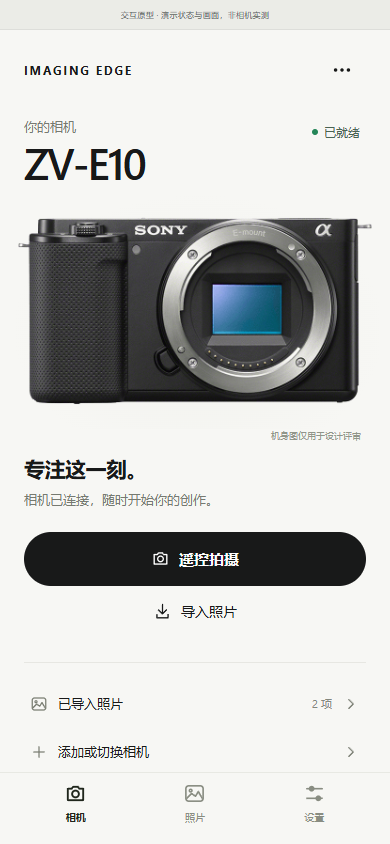
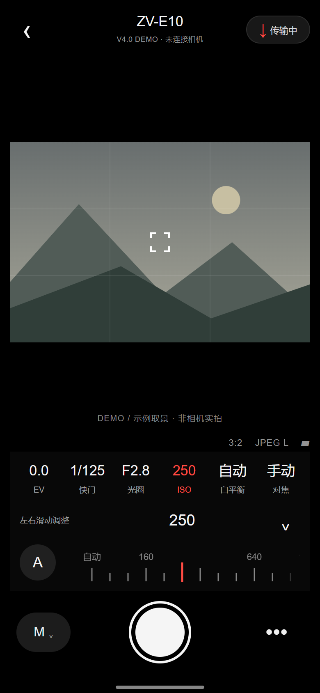
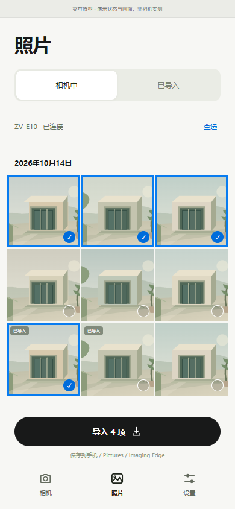

# Imaging Edge Pro · 个人修改版

拍照时临时切到后台回消息，回来继续遥控拍摄。界面也更清爽：常用参数直接在取景下方调整，不必跳到满屏设置。

**[下载 4.0.1 安装包](https://github.com/kcwuy/imaging-edge-pro/releases/download/v4.0.1/Imaging-Edge-7.8.6-V4.0.1.apk)** · [查看更新](https://github.com/kcwuy/imaging-edge-pro/releases/tag/v4.0.1)

## 为什么做这个版本

新版 Creators’ App 的适用名单没有第一代 ZV-E10、α6400 等老机型，它们仍使用 Imaging Edge Mobile。希望这些相机也能有清爽、顺手的手机操作体验。[Sony 官方应用与机型说明](https://www.sony.com/electronics/support/articles/00284526)

## 这版改了什么

- 后台保持连接：出去回消息，再回来继续拍照。
- 清爽主页与拍摄界面，调整参数时取景不跳动，中文读数更清楚。
- 修复加载时两个提示框重叠；已有型号资料可用时，后台返回不再自动弹出可选下载。
- 补充 α6400 等 11 款机型的连接说明，区分遥控和导入步骤，支持按机型查看菜单。

用户已在小米 15 / Android 16 与 ZV-E10 一代上确认此前后台断连及相机照片持续加载问题恢复。**4.0.1 的两项新修订以及其他相机仍需实机反馈。**

## 机型与连接

本轮补充：ZV-E10 一代；α6000、α6100、α6300、α6400、α6500、α6600；α7 II、α7 III、α7R II、α7R III。

这些机型属于 Sony 官方 IEM 适用范围，本轮增加了对应连接引导，未宣称本修改版已逐一实测。可调参数由相机、镜头和拍摄模式决定。[查看机型与连接说明](COMPATIBILITY.md)

## 界面预览

以下为界面原型，使用演示内容，不含私人照片；连接和取景均为示意。

**相机主页**

**遥控拍摄与参数调整**

**照片浏览**

## 开始使用

1. 下载 APK 安装。此前同签名修改版可覆盖；官方版签名不同，不能直接覆盖，卸载前请备份照片与设置。
2. 在相机上打开对应的智能手机遥控或传输功能，按应用引导连接相机 Wi-Fi。
3. 选择遥控拍摄或导入照片。相机 Wi-Fi 没有互联网属于正常情况。

基于 Imaging Edge Mobile 7.8.6 的个人非官方修改版，与 Sony 无隶属或合作关系。Sony 原组件及商标权利归各自权利人所有。
